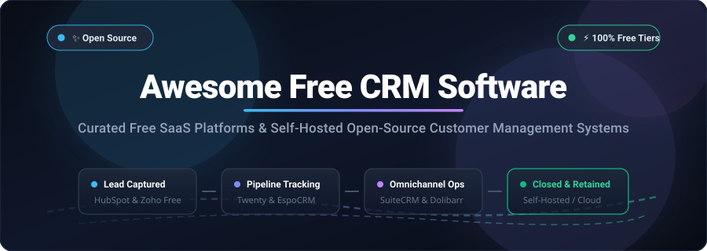

# 🌟 Awesome Free CRM Software

  

  
  
  
  
  
  
  

> 🎯 **A comprehensive, SEO-optimized curated directory of the best Free CRM Software.**  
> Featuring top commercial SaaS platforms offering generous forever-free tiers and powerful self-hosted, privacy-first open-source customer relationship management systems.  
> 🌟 *Star this repository to keep track of the latest additions and updates!* 🌟

---

## 📑 Table of Contents

- [📊 Sector Overview & Market Dynamics](#-sector-overview--market-dynamics)
- [☁️ Top SaaS CRM Platforms (Free Forever Tiers)](#️-top-saas-crm-platforms-free-forever-tiers)
- [💻 Open-Source & Self-Hosted CRM Solutions](#-open-source--self-hosted-crm-solutions)
  - [Twenty](#twenty-)
  - [Monica](#monica-)
  - [Krayin CRM](#krayin-crm-)
  - [Comp AI CRM](#comp-ai-crm-)
  - [IDURAR ERP CRM](#idurar-erp-crm-)
  - [Ever Gauzy](#ever-gauzy-)
  - [Dolibarr ERP CRM](#dolibarr-erp-crm-)
  - [SuiteCRM](#suitecrm-)
  - [Frappe CRM](#frappe-crm-)
  - [EspoCRM](#espocrm-)
  - [Django-CRM](#django-crm-)
  - [DaybydayCRM](#daybydaycrm-)
  - [YetiForce CRM](#yetiforce-crm-)
  - [OroCRM](#orocrm-)
  - [CiviCRM](#civicrm-)
  - [NextCRM](#nextcrm-)
  - [Warpdrive](#warpdrive-)
- [⚖️ Complete Architecture & Stack Comparison](#️-complete-architecture--stack-comparison)
- [🤝 Contributing](#-contributing)
- [💖 Support & Sponsorship](#-support--sponsorship)
- [📈 Star History](#-star-history)
- [📄 License](#-license)

---

## 📊 Sector Overview & Market Dynamics

The global **Customer Relationship Management (CRM)** software market was valued at approximately **$79.4 billion in 2024** and is forecasted to surpass **$160+ billion by 2030**, compounding at a robust annual growth rate (**CAGR**) of **~12.5%**. CRM continues to represent the single largest and fastest-growing category in enterprise software, fueled by omnichannel customer engagement, AI copilot workflows, and revenue intelligence automation.

From a structural perspective, the CRM ecosystem displays a **bimodal (barbell) market concentration**:
- **High-End Enterprise Consolidation:** The upper enterprise segment is intensely concentrated around a handful of mega-vendors (Salesforce, Microsoft Dynamics 365, Oracle, SAP, and HubSpot), who control over 50% of total industry revenue through deep ecosystem moats and multi-cloud contracts.
- **SMB & Mid-Market Fragmentation:** Conversely, the small-to-midsize business (SMB), startup, agency, and solopreneur segments are **moderately-to-highly fragmented**. Hundreds of agile point solutions compete on user experience, specialized vertical workflows (e-commerce, agencies, real estate), transparent pricing, and generous free plans. Simultaneously, concerns over data sovereignty, GDPR/HIPAA compliance, vendor lock-in, and unpredictable per-seat pricing have ignited rapid adoption of **self-hosted, open-source CRMs** (such as Twenty, SuiteCRM, and Frappe CRM).

---

## ☁️ Top SaaS CRM Platforms (Free Forever Tiers)

The table below catalogs premier cloud-hosted CRM solutions offering genuine **forever-free plans** (no forced credit cards). The entries are sorted **descending by company scale** (estimated valuation or market capitalization / annual recurring revenue).

| 🏢 Platform | 💰 Company Size (Valuation / ARR) | 🏷️ Paid Starting Tier Price | 🎁 Free Tier Limits & Inclusions | 🎯 Best For |
|:---|:---|:---|:---|:---|
| [**HubSpot Free CRM**](https://www.hubspot.com/products/crm) | **~$32.5B Market Cap** *(NYSE: HUBS / ~$2.2B ARR)* | **$15/seat/month** *(Starter Plan, billed annually; $20/mo month-to-month)* | Forever free for **up to 2 users**, 1,000 marketing contacts, unlimited deals & tasks, 1 pipeline, 1 shared inbox, 200 email open notifications/mo | Growing sales teams seeking an AI-assisted CRM with full marketing suite upgradeability |
| [**Zoho CRM Free**](https://www.zoho.com/crm/) | **~$12.0B Est. Valuation** *(Bootstrapped / ~$1.3B ARR)* | **$14/user/month** *(Standard Plan, billed annually; $20/user/mo monthly)* | Forever free for **up to 3 users**, 5,000 total records, 10 email templates, standard workflow rules, 5,000 daily API calls, mobile apps | Small businesses and solopreneurs already leveraging the broader Zoho application ecosystem |
| [**Freshsales Free**](https://www.freshworks.com/crm/sales/) | **~$4.5B Market Cap** *(NASDAQ: FRSH / ~$600M+ ARR)* | **$9/user/month** *(Growth Plan, billed annually; $11/user/mo monthly)* | Forever free for **up to 3 users**, 1,000 contacts, built-in cloud telephony, live chat widget, Kanban deal boards, 24/5 support | Sales teams prioritizing outbound calling, direct inbound telephone dialing, and website chat |
| [**Bitrix24**](https://www.bitrix24.com/) | **~$500M Est. Valuation** *(Bitrix, Inc. / ~$80M+ ARR)* | **$49/month flat for 5 users** *(~$9.80/user/mo, Basic tier billed annually)* | Forever free for **unlimited users**, 5 GB cloud storage, unlimited deals & invoices, video meetings (up to 48 pax), CoPilot AI *(inactive accounts purged after 50 days)* | Distributed teams wanting CRM seamlessly unified with team chat, tasks, docs, and video calls |
| [**Apptivo**](https://www.apptivo.com/) | **~$120M Est. Valuation** *(Apptivo Inc. / ~$25M ARR)* | **$10/user/month** *(Lite Plan, billed annually; $12/user/mo monthly)* | Forever free Standard plan for **1 user**, 500 contacts, standard lead/opportunity tracking, 100 MB cloud storage | Solo founders and independent consultants seeking modular business and customer management |
| [**Streak**](https://www.streak.com/) | **~$80M Est. Valuation** *(Streak, Inc. / ~$15M ARR)* | **$49/user/month** *(Pro Plan, billed annually; $59/user/mo monthly)* | Forever free for **1 user**, 500 email tracking views/mo, 50 mail merges/day; pipelines require a **14-day full Pro trial** *(no credit card required)* | Founders and dealmakers who live inside Gmail and want pipeline tracking directly in their inbox |
| [**Capsule CRM**](https://capsulecrm.com/) | **~$60M Est. Valuation** *(Zestia Ltd / ~$12M ARR)* | **$18/user/month** *(Starter Plan, billed annually; $21/user/mo monthly)* | Forever free for **up to 2 users**, 250 contacts, 1 sales pipeline, 50 MB storage, 5 custom fields, Outlook & Gmail extensions | Agencies, freelancers, and small practices looking for a clutter-free, minimalist contact manager |
| [**Vtiger Cloud**](https://www.vtiger.com/) | **~$55M Est. Valuation** *(Vtiger Systems / ~$15M ARR)* | **$12/user/month** *(One Growth, billed annually; $15/user/mo monthly)* | Forever free Pilot tier for **up to 10 users**, 3,000 records, standard contact & deal pipeline management, helpdesk ticketing | Organizations seeking a unified CRM and ticketing desk with an easy pathway to open-source migration |
| [**EngageBay**](https://www.engagebay.com/) | **~$40M Est. Valuation** *(EngageBay Inc. / ~$8M ARR)* | **$11.95/user/month** *(Basic Plan, billed annually; $13.79/user/mo monthly)* | Forever free for **up to 15 users**, 250 contacts, 1,000 branded marketing emails/month, deal pipelines, live chat, service ticketing | Startups seeking an affordable HubSpot substitute combining sales pipeline, marketing emails, and tickets |
| [**Flowlu**](https://www.flowlu.com/) | **~$20M Est. Valuation** *(Flowlu Inc. / ~$4M ARR)* | **$29/month flat for 8 users** *(~$3.62/user/mo, Team Plan billed annually)* | Forever free for **up to 2 users**, 20 contacts/leads, 1 project workspace, 1 sales pipeline, 1 GB storage, invoicing module | Creative agencies and IT contractors needing integrated CRM, project boards, and client billing |

---

## 💻 Open-Source & Self-Hosted CRM Solutions

Below is the definitive catalog of self-hosted open-source CRM software packages. All repositories have been validated, provide accessible source code, and are **strictly sorted descending by GitHub star count**. Beside each project name is an interactive social star badge linking directly to that project's stargazers community.

| 📦 Repository | ⭐ GitHub Popularity | 📜 License | 🛠️ Technology Stack | 💡 Primary Use Case |
|:---|:---|:---|:---|:---|
| [**Twenty**](https://github.com/twentyhq/twenty) |  | AGPL-3.0 | TypeScript, NestJS, React, PostgreSQL | Modern, AI-first open alternative to Salesforce & HubSpot |
| [**Monica**](https://github.com/monicahq/monica) |  | AGPL-3.0 | PHP, Laravel, MySQL | Personal relationship manager (PRM) for friends & professional networks |
| [**Krayin CRM**](https://github.com/krayin/laravel-crm) |  | MIT | PHP, Laravel, MySQL | Highly customizable, low-code Laravel CRM with Kanban pipelines |
| [**Comp AI CRM**](https://github.com/trycompai/crm) |  | AGPL-3.0 | TypeScript, Next.js, AI Agents | Autonomous agentic-first CRM built for AI sales copilots |
| [**IDURAR ERP CRM**](https://github.com/idurar/idurar-erp-crm) |  | MIT | Node.js, Express, React, MongoDB | Modern full-stack JavaScript CRM, accounting, and invoice generator |
| [**Ever Gauzy**](https://github.com/ever-co/ever-gauzy) |  | AGPL-3.0 / Fair Source | TypeScript, NestJS, Angular, TypeORM | Complete business ops platform blending CRM, HRM, and project tracking |
| [**Dolibarr**](https://github.com/Dolibarr/dolibarr) |  | GPL-3.0 | PHP, MySQL, MariaDB | Modular ERP + CRM with leads, invoices, inventory, and order management |
| [**SuiteCRM**](https://github.com/SuiteCRM/SuiteCRM) |  | AGPL-3.0 | PHP, Symfony, Angular, MariaDB | Mature enterprise-grade SugarCRM successor with complete sales & service suite |
| [**Frappe CRM**](https://github.com/frappe/crm) |  | GPL-3.0 | Python, Frappe Framework, Vue.js | Modern, reactive CRM natively integrated with ERPNext & Frappe ecosystem |
| [**EspoCRM**](https://github.com/espocrm/espocrm) |  | GPL-3.0 | PHP, Backbone.js SPA, MySQL | Lightweight, lightning-fast CRM with dynamic layouts and REST API |
| [**Django-CRM**](https://github.com/MicroPyramid/Django-CRM) |  | MIT | Python, Django, PostgreSQL | Developer-friendly CRM with clean Python codebase for rapid customization |
| [**DaybydayCRM**](https://github.com/Bottelet/DaybydayCRM) |  | MIT | PHP, Laravel, Blade, MySQL | Minimalist, clean task and lead tracking system for small service firms |
| [**YetiForce CRM**](https://github.com/YetiForceCompany/YetiForceCRM) |  | GPL-3.0 | PHP, MySQL, JavaScript | Feature-packed powerhouse with 100+ native business modules (Vtiger fork) |
| [**OroCRM**](https://github.com/oroinc/crm-application) |  | OSL-3.0 | PHP, Symfony, Doctrine, PostgreSQL | Robust enterprise multichannel CRM built on the flexible OroPlatform |
| [**CiviCRM**](https://github.com/civicrm/civicrm-core) |  | AGPL-3.0 | PHP, MySQL, WordPress/Drupal | Specialized CRM designed specifically for nonprofits, NGOs, and civic bodies |
| [**NextCRM**](https://github.com/pdovhomilja/nextcrm-app) |  | MIT | TypeScript, Next.js 16, Prisma, shadcn | Modern App Router CRM with project tasks, PDF invoicing, and AI summaries |
| [**Warpdrive**](https://github.com/sneg55/warpdrive) |  | AGPL-3.0 | TypeScript, React, Next.js | Dedicated Pipedrive clone with Kanban deal workspaces and Gmail sync |

---

### Detailed Open-Source Profiles

### Twenty 
- **Repository:** [`twentyhq/twenty`](https://github.com/twentyhq/twenty)
- **Stack:** TypeScript • NestJS • React • PostgreSQL • GraphQL
- **License:** AGPL-3.0
- **Overview:** Twenty is modern, beautifully architected, and positioned as the open-source alternative to Salesforce. It delivers a modern, reactive SaaS-style interface, custom database objects, flexible Kanban boards, two-way email synchronization, fine-grained access control, and a full GraphQL API.
- **Best For:** Modern engineering teams, VC-backed startups, and organizations that demand a slick, contemporary CRM experience self-hosted on Docker or Kubernetes.

### Monica 
- **Repository:** [`monicahq/monica`](https://github.com/monicahq/monica)
- **Stack:** PHP • Laravel • MySQL • Vue.js
- **License:** AGPL-3.0
- **Overview:** Monica is a Personal Relationship Manager (PRM) created to remember everything about your friends, family, and professional acquaintances. It logs significant life milestones, conversations, reminders, gifts given, and contact details without ad-tracking or data monetization.
- **Best For:** Individuals, executives, and networking enthusiasts wanting to track genuine personal and business connections privately.

### Krayin CRM 
- **Repository:** [`krayin/laravel-crm`](https://github.com/krayin/laravel-crm)
- **Stack:** PHP • Laravel • MySQL
- **License:** MIT
- **Overview:** Built entirely on Laravel, Krayin CRM provides enterprise CRM mechanics with an approachable low-code codebase. It handles lead routing, deal funnels, custom attribute mapping, automated email triggers, and role-based permissions under a permissive MIT license.
- **Best For:** Laravel developers and digital agencies needing an unencumbered foundation to build custom, white-labeled client portals.

### Comp AI CRM 
- **Repository:** [`trycompai/crm`](https://github.com/trycompai/crm)
- **Stack:** TypeScript • Next.js • React • PostgreSQL • LLM Tooling
- **License:** AGPL-3.0
- **Overview:** An agentic-first CRM designed from the ground up for autonomous AI sales reps and assistants. Allows AI agents to research prospects, drafts emails, update stage probabilities, and coordinate deals through standardized model context protocols (MCP).
- **Best For:** AI-forward sales operations and developers building automated agentic outbound pipelines.

### IDURAR ERP CRM 
- **Repository:** [`idurar/idurar-erp-crm`](https://github.com/idurar/idurar-erp-crm)
- **Stack:** Node.js • Express • React • MongoDB • Ant Design
- **License:** MIT
- **Overview:** IDURAR is a lightweight, responsive ERP/CRM system specializing in customer tracking, quote generation, sales orders, payment reconciliations, and automated PDF invoicing.
- **Best For:** Small business owners, digital marketing agencies, and freelancers who need unified CRM and billing.

### Ever Gauzy 
- **Repository:** [`ever-co/ever-gauzy`](https://github.com/ever-co/ever-gauzy)
- **Stack:** TypeScript • NestJS • Angular • TypeORM • PostgreSQL
- **License:** AGPL-3.0 / Fair Source
- **Overview:** Gauzy is a comprehensive open business management suite uniting CRM, human resource management (HRM), timesheet tracking, payroll calculations, and project management.
- **Best For:** Remote-first companies, consulting firms, and agencies requiring integrated workforce management alongside lead pipelines.

### Dolibarr ERP CRM 
- **Repository:** [`Dolibarr/dolibarr`](https://github.com/Dolibarr/dolibarr)
- **Stack:** PHP • MySQL / MariaDB
- **License:** GPL-3.0
- **Overview:** In continuous development for over two decades, Dolibarr provides an extensible modular ERP/CRM architecture. Features include commercial proposals, contracts, customer databases, inventory management, point-of-sale (POS), and double-entry accounting.
- **Best For:** Small-to-medium enterprises, non-profits, and service contractors seeking a rock-solid, all-in-one operations system.

### SuiteCRM 
- **Repository:** [`SuiteCRM/SuiteCRM`](https://github.com/SuiteCRM/SuiteCRM)
- **Stack:** PHP • Symfony • MariaDB • Angular
- **License:** AGPL-3.0
- **Overview:** Originally launched as a community-maintained fork of SugarCRM CE, SuiteCRM is one of the world's most battle-tested open-source enterprise CRMs. It includes advanced sales automation, campaign marketing, customer service ticketing, workflow engines, and reporting modules.
- **Best For:** Large institutions, healthcare networks, and enterprises seeking a proven self-hosted replacement for expensive commercial suites.

### Frappe CRM 
- **Repository:** [`frappe/crm`](https://github.com/frappe/crm)
- **Stack:** Python • Frappe Framework • Vue.js • MariaDB
- **License:** GPL-3.0
- **Overview:** Engineered on top of the Frappe framework, Frappe CRM introduces a clean, minimalist UI for lead scoring, deal velocity tracking, email synchronizations, and telephony. Integrates out-of-the-box with ERPNext.
- **Best For:** Businesses already leveraging ERPNext or organizations seeking a modular Python-centric sales engine.

### EspoCRM 
- **Repository:** [`espocrm/espocrm`](https://github.com/espocrm/espocrm)
- **Stack:** PHP • Backbone.js SPA • MySQL / MariaDB
- **License:** GPL-3.0
- **Overview:** EspoCRM is engineered for blazing speed and adaptability. It features an intuitive single-page app interface, dynamic layout managers, lead lifecycle automation, inbound email-to-case generation, and full calendar sync (Google/Outlook).
- **Best For:** Lean operations seeking a fast, lightweight, and easily maintainable self-hosted CRM.

### Django-CRM 
- **Repository:** [`MicroPyramid/Django-CRM`](https://github.com/MicroPyramid/Django-CRM)
- **Stack:** Python • Django • PostgreSQL / SQLite
- **License:** MIT
- **Overview:** An open-source CRM written in pure Python and Django. Features contact directories, lead routing, visual sales pipelines, case tickets, and team comments without bloated enterprise overhead.
- **Best For:** Django and Python engineering teams that need a clean code repository to hack, extend, or embed into internal tools.

### DaybydayCRM 
- **Repository:** [`Bottelet/DaybydayCRM`](https://github.com/Bottelet/DaybydayCRM)
- **Stack:** PHP • Laravel • Bootstrap • MySQL
- **License:** MIT
- **Overview:** An uncluttered CRM oriented around day-to-day workflow tracking. Manages client accounts, deal phases, task checklists, appointments, and project milestones in a simple dashboard.
- **Best For:** Freelance professionals and micro-teams wanting zero configuration overhead.

### YetiForce CRM 
- **Repository:** [`YetiForceCompany/YetiForceCRM`](https://github.com/YetiForceCompany/YetiForceCRM)
- **Stack:** PHP • MySQL • jQuery • Bootstrap
- **License:** GPL-3.0
- **Overview:** An exhaustive fork of Vtiger with over 100 native modules included. Covers GDPR compliance tooling, PBX telephone integrations, ticket queues, warehouse inventory, project tracking, and deep audit logs.
- **Best For:** Regulated businesses requiring extreme customization and complex auditing out-of-the-box.

### OroCRM 
- **Repository:** [`oroinc/crm-application`](https://github.com/oroinc/crm-application)
- **Stack:** PHP • Symfony • Doctrine • PostgreSQL / MySQL
- **License:** OSL-3.0
- **Overview:** OroCRM was created by the original founders of Magento to deliver a flexible multichannel 360-degree customer view. Excels at omnichannel customer journey analysis, e-commerce sync, and segmented email marketing.
- **Best For:** Omnichannel retailers and enterprises building high-volume B2B/B2C commercial portals.

### CiviCRM 
- **Repository:** [`civicrm/civicrm-core`](https://github.com/civicrm/civicrm-core)
- **Stack:** PHP • MySQL • WordPress / Drupal / Joomla
- **License:** AGPL-3.0
- **Overview:** The undisputed standard in non-profit, advocacy, and membership CRM. Integrates directly into CMS backends to manage donor contributions, pledge campaigns, event registrations, and civic engagement records.
- **Best For:** Non-profit charities, advocacy groups, educational trusts, and political campaigns.

### NextCRM 
- **Repository:** [`pdovhomilja/nextcrm-app`](https://github.com/pdovhomilja/nextcrm-app)
- **Stack:** TypeScript • Next.js 16 • React 19 • Prisma • PostgreSQL
- **License:** MIT
- **Overview:** A cutting-edge full-stack Next.js app implementing lead management, task boards, automated PDF quote & invoice rendering, email correspondence, and AI document extraction using shadcn/ui.
- **Best For:** TypeScript full-stack developers desiring a modern starter architecture for custom client portals.

### Warpdrive 
- **Repository:** [`sneg55/warpdrive`](https://github.com/sneg55/warpdrive)
- **Stack:** TypeScript • React • Next.js • Tailwind CSS
- **License:** AGPL-3.0
- **Overview:** Built specifically to replicate the intuitive pipeline drag-and-drop experience of Pipedrive. Includes two-way Google Workspace / Gmail synchronization and deal velocity trackers.
- **Best For:** Sales executives who love the Pipedrive UX but require data self-hosting.

---

## ⚖️ Complete Architecture & Stack Comparison

| 📦 Solution | 🏢 Hosting Model | 📜 License / Terms | 💻 Tech Stack | 👥 Free Tier Limit / Capacity |
|:---|:---|:---|:---|:---|
| **HubSpot Free** | Cloud SaaS | Proprietary | Proprietary Cloud | 2 Users, 1k Contacts, Unlimited Deals |
| **Zoho CRM Free** | Cloud SaaS | Proprietary | Proprietary Cloud | 3 Users, 5k Records, Mobile Apps |
| **Freshsales Free** | Cloud SaaS | Proprietary | Proprietary Cloud | 3 Users, 1k Contacts, Cloud Telephony |
| **Bitrix24 Free** | Cloud SaaS | Proprietary | Proprietary Cloud | Unlimited Users, 5 GB Drive, CoPilot AI |
| **Apptivo Standard** | Cloud SaaS | Proprietary | Proprietary Cloud | 1 User, 500 Contacts, 100 MB Storage |
| **Streak** | Gmail Extension | Proprietary | Google Workspace | 1 User, 500 Tracked Emails/mo, 14-day CRM Trial |
| **Capsule Free** | Cloud SaaS | Proprietary | Proprietary Cloud | 2 Users, 250 Contacts, 1 Pipeline |
| **Vtiger Cloud** | Cloud SaaS | Proprietary | Proprietary Cloud | 10 Users, 3k Records, Integrated Tickets |
| **EngageBay Free** | Cloud SaaS | Proprietary | Proprietary Cloud | 15 Users, 250 Contacts, 1k Branded Emails/mo |
| **Flowlu Free** | Cloud SaaS | Proprietary | Proprietary Cloud | 2 Users, 20 Contacts, 1 Project, 1 GB Storage |
| **Twenty** | Self-Hosted | AGPL-3.0 | TypeScript / NestJS / React | Unlimited Self-Hosted |
| **Monica** | Self-Hosted | AGPL-3.0 | PHP / Laravel / Vue.js | Unlimited Self-Hosted (PRM) |
| **Krayin CRM** | Self-Hosted | MIT | PHP / Laravel / MySQL | Unlimited Self-Hosted |
| **Comp AI CRM** | Self-Hosted | AGPL-3.0 | TypeScript / Next.js / AI Tools | Unlimited Self-Hosted |
| **IDURAR ERP CRM** | Self-Hosted | MIT | Node.js / React / MongoDB | Unlimited Self-Hosted |
| **Ever Gauzy** | Self-Hosted | AGPL-3.0 | TypeScript / NestJS / Angular | Unlimited Self-Hosted |
| **Dolibarr** | Self-Hosted | GPL-3.0 | PHP / MySQL / MariaDB | Unlimited Self-Hosted |
| **SuiteCRM** | Self-Hosted | AGPL-3.0 | PHP / Symfony / MariaDB | Unlimited Self-Hosted |
| **Frappe CRM** | Self-Hosted | GPL-3.0 | Python / Frappe / Vue.js | Unlimited Self-Hosted |
| **EspoCRM** | Self-Hosted | GPL-3.0 | PHP / Backbone SPA / MySQL | Unlimited Self-Hosted |
| **Django-CRM** | Self-Hosted | MIT | Python / Django / PostgreSQL | Unlimited Self-Hosted |
| **DaybydayCRM** | Self-Hosted | MIT | PHP / Laravel / Bootstrap | Unlimited Self-Hosted |
| **YetiForce CRM** | Self-Hosted | GPL-3.0 | PHP / MySQL / Bootstrap | Unlimited Self-Hosted |
| **OroCRM** | Self-Hosted | OSL-3.0 | PHP / Symfony / PostgreSQL | Unlimited Self-Hosted |
| **CiviCRM** | Self-Hosted | AGPL-3.0 | PHP / MySQL / CMS Plugins | Unlimited Self-Hosted |
| **NextCRM** | Self-Hosted | MIT | TypeScript / Next.js / Prisma | Unlimited Self-Hosted |
| **Warpdrive** | Self-Hosted | AGPL-3.0 | TypeScript / React / Next.js | Unlimited Self-Hosted |

---

## 🤝 Contributing

Contributions are warmly welcomed! If you have built or discovered an awesome free or open-source CRM that deserves recognition here, please submit a pull request!

1. Check that the project is actively maintained (releases or commits within the last 12 months).
2. For open-source additions, ensure the source code is public and carries an recognized open-source license.
3. For SaaS additions, ensure it provides an authentic forever-free plan or transparent trial.
4. Follow the existing tabular structure, including stack, license, and star badges.
5. Explore other curated lists at [Awesome Awesome Awesome](https://github.com/ishandutta2007/Awesome-Awesome-Awesome)!

---

## 💖 Support & Sponsorship

Thank you for visiting and supporting **Awesome Free CRM Software**! If this list saved you hours of research, helped you migrate off exorbitant per-seat subscriptions, or empowered your team to deploy a self-hosted CRM, please consider supporting this project:

- ⭐ **Star this repository** to improve visibility across the GitHub community!
- 🍴 **Fork and share** with fellow developers, entrepreneurs, and DevOps engineers!
- ☕ **Buy a coffee or sponsor ongoing maintenance:**  
    
  👉 Direct Sponsor Dashboard: **[http://github.com/sponsors/ishandutta2007](http://github.com/sponsors/ishandutta2007)**

Your generous sponsorship keeps these curated open-source developer directories updated and accessible to everyone worldwide!

---

## 📈 Star History

---

## 📄 License

This repository and compilation are distributed under the [CC0 1.0 Universal (Public Domain Dedication)](https://creativecommons.org/publicdomain/zero/1.0/).  
All trademarks, logos, and software products referenced herein remain the property of their respective creators and owners.

---

  Maintained with ❤️ by <a href="https://github.com/ishandutta2007">Ishan Dutta</a> and the open-source community.

